# Qubit Lab

An open-source simulator for learning superconducting qubits, from the equations in the papers to full open-system simulation, in an interactive 3D explorer. For students, engineers and researchers.

Every equation carries its paper and equation number, and is checked against a simulation built on maintained open-source solvers: Dynamiqs, scqubits, Stim, PyMatching and JAX.

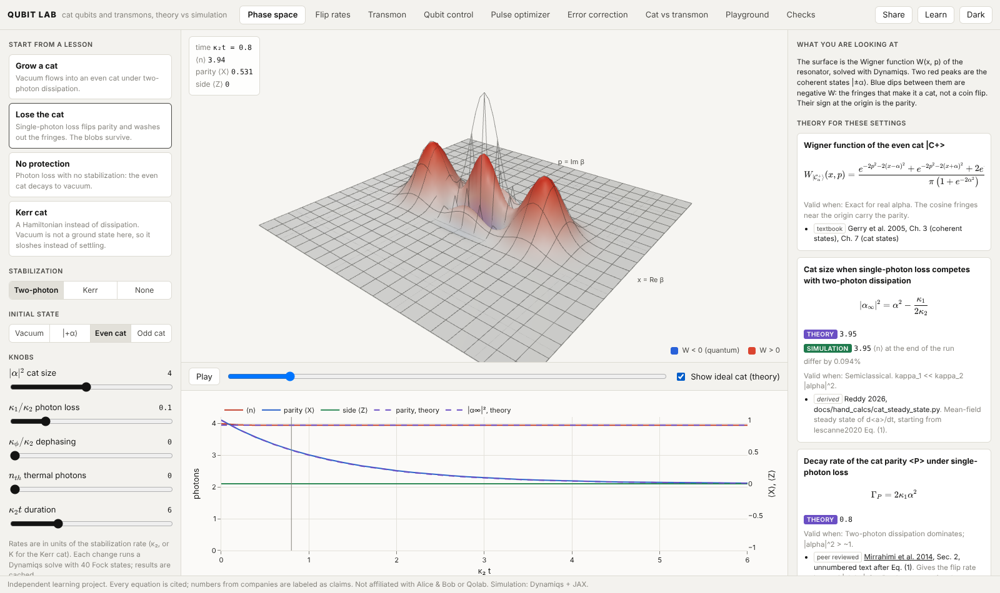

| | |
| --- | --- |
| 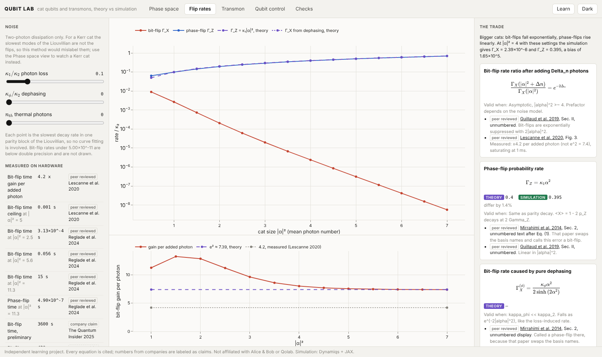 | 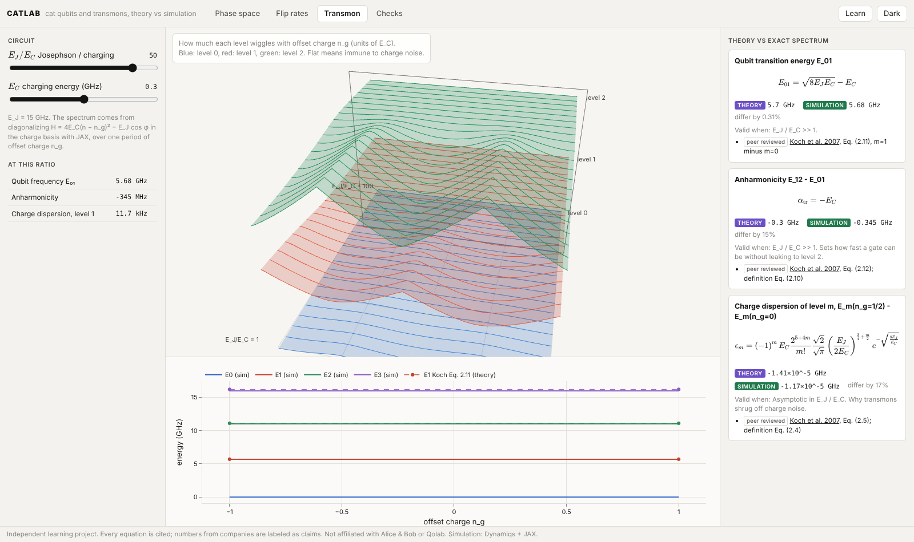 |
| 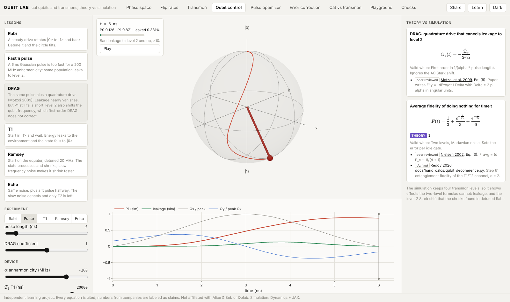 |  |
| 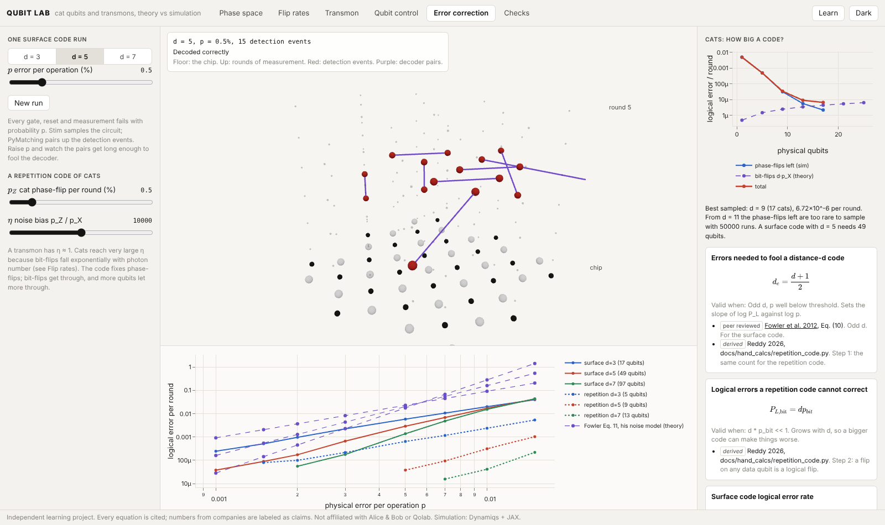 | 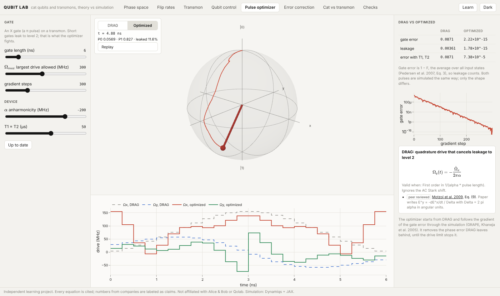 |
| 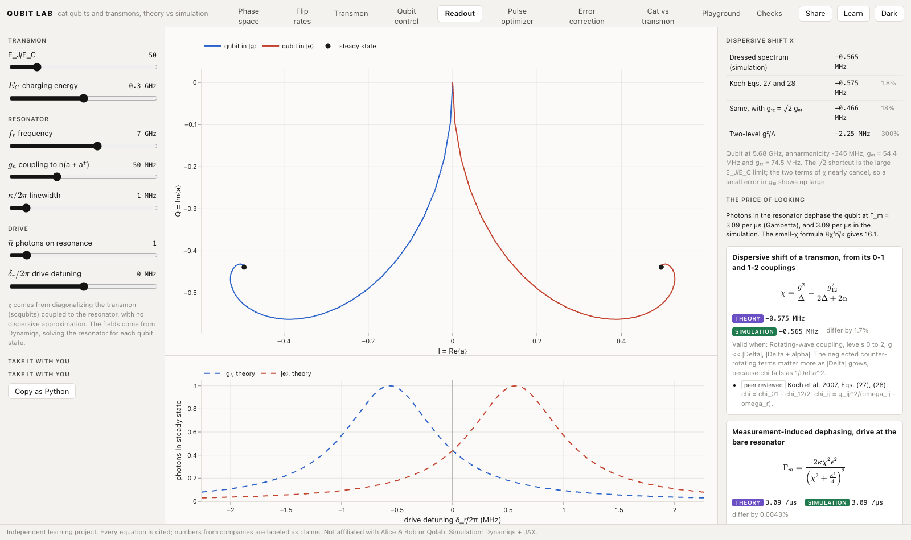 | 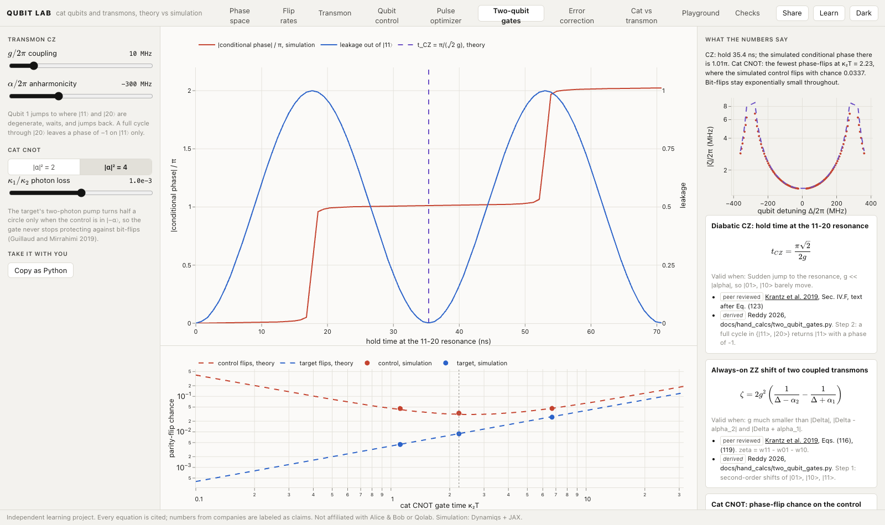 |
| 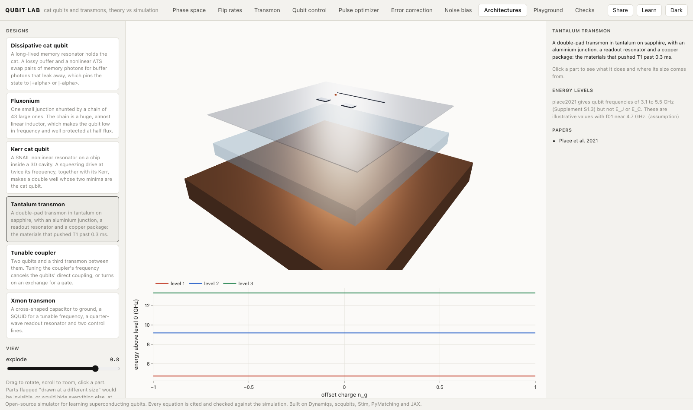 | 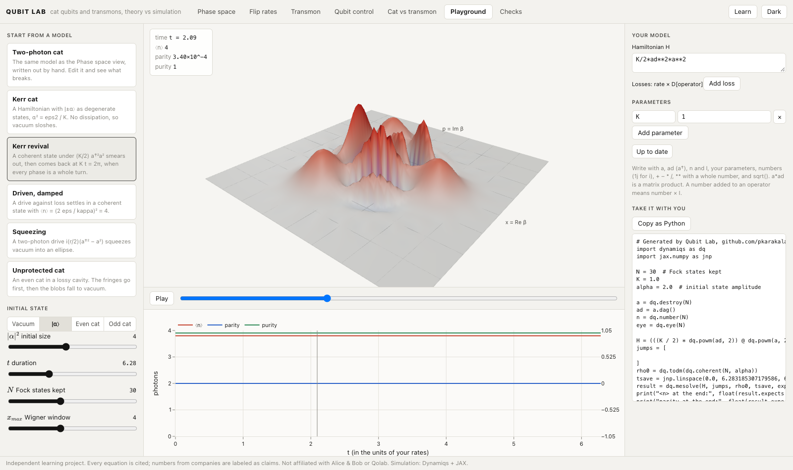 |
| 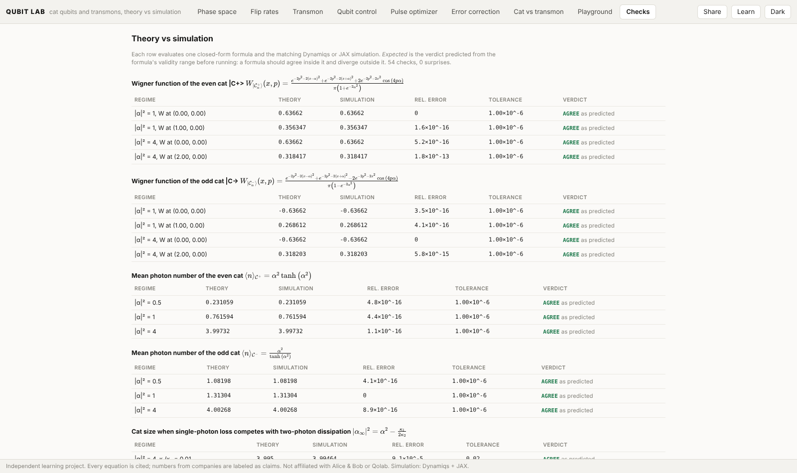 | |

## What you can do

| View | Try this |
| --- | --- |
| Phase space | Grow a cat qubit from vacuum, then watch photon loss wash out its fringes, with the ideal cat from theory as a wireframe. |
| Flip rates | Drag the cat size and watch bit-flips fall exponentially while phase-flips rise linearly. |
| Transmon | Drag E_J/E_C and watch the charge bands flatten in 3D, next to the closed forms of Koch et al. |
| Qubit control | Run Rabi, π pulse, DRAG, T1, Ramsey and echo on a 4-level transmon and follow the Bloch vector. |
| Readout | Watch a qubit pull its resonator by ±χ, and compare χ from the exact spectrum with three textbook formulas. |
| Pulse optimizer | Let gradient descent through the simulation design a fast gate, and compare it with DRAG. |
| Noise bias | Compare bit-flip and phase-flip chances for cats and transmons at measured, cited hardware numbers. |
| Error correction | Run surface and repetition codes with Stim, decode with PyMatching, and see errors in space-time. |
| Two-qubit gates | Run a transmon CZ through the 11-20 crossing and a bias-preserving cat CNOT, next to the papers' error formulas. |
| Architectures | Explode six qubit designs, from the Xmon to the Kerr cat, into their layers, with every size cited or marked schematic. |
| Playground | Type your own Hamiltonian and losses, watch the Wigner function evolve, and copy the run as Python. |

Every view has **Share** (a link that restores its inputs) and **Copy as Python** (a script that reproduces it).

## How we know it's right

Each formula is compared with a simulation in a regime where it should hold and one where it should not, with the verdict written down before the run. A formula that misses where it should hold is reported, never hidden. The *Checks* view and [docs/reference/checks.md](docs/reference/checks.md) list every comparison; `qubitlab checks` runs them in the terminal.

## Run

Once a release is on PyPI, one command, no Node needed:

```bash
pipx run qubitlab serve      # or: pip install qubitlab && qubitlab serve
```

It opens the explorer at http://127.0.0.1:8000. `qubitlab checks` prints every formula vs the simulation in the terminal.

From a clone, to change the code:

```bash
uv sync --all-groups
cd web && npm install && cd ..
./scripts/dev.sh           # API on :8000, explorer on :5173, both reload on save
```

To try the packaged build from a clone: `cd web && npm run build:package`, then `uv run qubitlab serve`.

## How it is built

Three layers, kept apart by a test:

- **Theory** (`src/qubitlab/theory/`): each equation is a SymPy expression with its paper and equation number, compiled to JAX.
- **Simulation** (`src/qubitlab/sim/`): Dynamiqs for the cat's and the driven transmon's Lindblad equations, scqubits for the transmon's spectrum, Stim and PyMatching for error correction, optax for pulse optimization.
- **Checks** (`src/qubitlab/checks/`): theory vs simulation, with the verdict predicted before running.

## Learn

Every view has a **Share** button. The link it copies reopens the same view with the same inputs.
Every view also has **Copy as Python**: a short script that calls `qubitlab` with the inputs on screen and prints
the simulation next to its theory. CI runs every script, so they stay in step with the code.

Start with [docs/learn/](docs/learn/): a short course in five parts, from states and noise to qubit designs, control, gates and error correction. Every equation is listed with its source in [docs/reference/formulas.md](docs/reference/formulas.md), and every comparison in [docs/reference/checks.md](docs/reference/checks.md).

## Limits

The cat model is the standard effective one: a single mode with two-photon dissipation, no buffer mode. Chip geometry is schematic or taken from papers; computing it from a layout with Palace is next (see [ROADMAP.md](ROADMAP.md)). Rates are in units of κ₂, not hertz. Hardware numbers come from peer-reviewed papers, shown as cited facts, never fitted. Not affiliated with any company or lab whose work is cited.

Parts of this repo were written with AI coding assistants, directed and reviewed by me. Agent rules are in [AGENTS.md](AGENTS.md).

Apache-2.0 · Pranav Reddy
