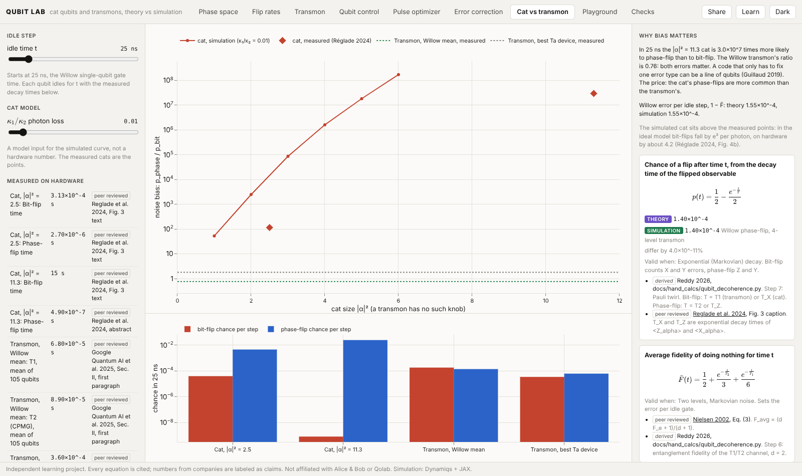

# Qubit Lab

Cat qubits and transmons, from closed-form theory to Dynamiqs simulation, in a 3D explorer. Write your own Hamiltonian in the Playground and copy it out as a Dynamiqs script.

A learning project. Alice & Bob build cat qubits; Qolab builds transmon-family qubits. Both are superconducting circuits, but they bet on different physics. qubitlab puts the equations from the papers next to a full simulation, so you can see where each formula holds and where it breaks.


| | |
| --- | --- |
|  |  |
|  |  |
|  |  |
|  |  |

## Findings

1. In the ideal two-photon model, each added photon cuts the bit-flip rate by e² ≈ 7.4 once |α|² ≳ 5. The 2020 experiment by Lescanne et al. measured 4.2.
2. The phase-flip rate κ₁|α|² matches simulation to 0.2% for |α|² ≥ 2, and is off by 86% at |α|² = 0.3. The exact two-cat result, 2κ₁|α|² coth(2|α|²), which we derive, matches there to 0.2%: the simple law only drops the small-cat correction.
3. Koch et al.'s transmon frequency holds to 1% for E_J/E_C ≥ 20, but the true anharmonicity is 10 to 15% larger in magnitude than E_C at E_J/E_C = 50 to 100.
4. On a 4-level transmon with α = −200 MHz, a 6 ns π pulse leaks 24% of the population to level 2. DRAG cuts that to 0.4%, but the pulse still misses |1⟩ by 13%: its peak drive is 0.67|α|, past where first-order DRAG holds, and level 2 also shifts the qubit frequency. The same shift makes the two-level Rabi formula miss by 1.8% for a detuned drive.
5. With Stim and PyMatching, the logical error of both codes falls as p^((d+1)/2), Fowler et al.'s exponent, to within 3%. For a repetition code of cats with bias η = 10⁴ and 0.5% phase-flips, the logical error stops improving at about 17 to 21 qubits, where the bit-flips it cannot correct (d·p_X) take over. A d = 5 surface code uses 49.
6. At measured hardware numbers, a cat at |α|² = 11.3 is about 3 × 10⁷ times more likely to phase-flip than bit-flip (Réglade et al. 2024). A Willow transmon's ratio is 0.76. Per 25 ns step, the cat still phase-flips about 180 times more often than the transmon.
7. Gradient descent through the simulation (GRAPE) finds a 6 ns X gate with error below 10⁻¹⁴ on a 4-level transmon with α = −200 MHz. The DRAG pulse it starts from has 8.7% error, and only 0.36% of that is leakage: the rest is a wrong rotation, from level 2 shifting the qubit frequency. With T1 = T2 = 50 µs the optimized gate reaches 7.4 × 10⁻⁵, the coherence limit.

## Run

Once a release is on PyPI, one command, no Node needed:

```bash
pipx run qubitlab serve      # or: pip install qubitlab && qubitlab serve
```

It opens the explorer at http://127.0.0.1:8000. `qubitlab checks` prints every formula vs the simulation in the terminal.

From a clone, to change the code:

```bash
uv sync --all-groups
cd web && npm install && cd ..
./scripts/dev.sh           # API on :8000, explorer on :5173, both reload on save
```

To try the packaged build from a clone: `cd web && npm run build:package`, then `uv run qubitlab serve`.

## How it is built

Three layers, kept apart by a test:

- **Theory** (`src/qubitlab/theory/`): each equation is a SymPy expression with its paper and equation number, compiled to JAX.
- **Simulation** (`src/qubitlab/sim/`): Dynamiqs for the cat's and the driven transmon's Lindblad equations, scqubits for the transmon's spectrum, Stim and PyMatching for error correction, optax for pulse optimization.
- **Checks** (`src/qubitlab/checks/`): theory vs simulation, with the verdict predicted before running.

## Learn

Every view has a **Share** button. The link it copies reopens the same view with the same inputs.
Every view also has **Copy as Python**: a short script that calls `qubitlab` with the inputs on screen and prints
the simulation next to its theory. CI runs every script, so they stay in step with the code.

Start with [docs/learn/](docs/learn/): ten one-screen pages. Every equation is listed with its source in [docs/reference/formulas.md](docs/reference/formulas.md), and every comparison in [docs/reference/checks.md](docs/reference/checks.md).

## Limits

The cat model is the standard effective one: a single mode with two-photon dissipation, no buffer mode, no gates yet. Rates are in units of κ₂, not hertz. Hardware numbers are shown as cited facts, never fitted. Not affiliated with Alice & Bob, Qolab, or any company cited.

Parts of this repo were written with AI coding assistants, directed and reviewed by me. Agent rules are in [AGENTS.md](AGENTS.md).

Apache-2.0 · Pranav Reddy
